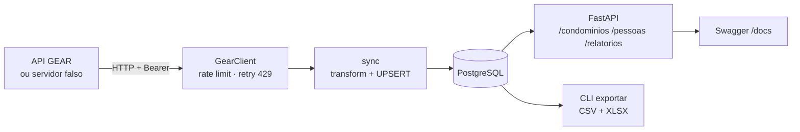

# Gear-Sync API


Serviço backend que **sincroniza a API Pública GEAR** (sistema de controle de acesso de condomínios)
com um banco **PostgreSQL** e expõe os dados tratados numa **API REST** com relatórios.

Nasceu de scripts que eu usava no trabalho para exportar moradores e funcionários dos condomínios
para planilhas. Aqui eles viraram um serviço: com banco, API, testes automatizados, Docker e CI.

> Todos os dados deste repositório são **fictícios** (gerados com Faker). Nenhum dado real, token
> ou documentação do fornecedor é versionado.

## Arquitetura



| Módulo | Responsabilidade |
|---|---|
| `client.py` | Cliente HTTP: autenticação, intervalo mínimo entre chamadas, espera e nova tentativa em HTTP 429, erros como exceções |
| `transform.py` | Converte o JSON da API em linhas do banco (datas, horários, CPF, grade semanal) — funções puras |
| `models.py` | Tabelas (SQLAlchemy 2.0): `condominiums`, `units`, `persons`, `sync_runs` |
| `sync.py` | Sincronização idempotente: **UPSERT** (`INSERT ... ON CONFLICT DO UPDATE`), remoção de quem saiu da API, uma transação por condomínio e histórico em `sync_runs` |
| `api.py` / `schemas.py` | API REST com filtros, paginação e relatórios; o CPF sai sempre mascarado |
| `mock_gear.py` | Servidor GEAR falso com dados fictícios, para rodar e testar sem token |
| `cli.py` | `gear-sync sync` e `gear-sync exportar` |
| `migrations/` | Versionamento do esquema do banco (Alembic) |

## Como rodar

### Com Docker (recomendado)

```bash
docker compose up --build -d          # Postgres + GEAR falso + API
docker compose run --rm sync          # sincroniza
```

Abra **http://localhost:8000/docs** para usar a API pelo Swagger.

Para usar a API GEAR real, crie um `.env` a partir do `.env.example` com `GEAR_TOKEN` e `GEAR_BASE_URL`.

### Sem Docker

```bash
python -m venv .venv
.venv\Scripts\activate                # Linux/Mac: source .venv/bin/activate
pip install -e ".[dev]"

uvicorn gear_sync.mock_gear:app --port 8001          # terminal 1: GEAR falso

set GEAR_BASE_URL=http://localhost:8001/api          # terminal 2 (Linux/Mac: export ...)
set GEAR_TOKEN=qualquer
alembic upgrade head                                 # cria as tabelas (SQLite gear.db se não houver DATABASE_URL)
gear-sync sync
gear-sync exportar --saida exportacao
uvicorn gear_sync.api:app --reload                   # http://localhost:8000/docs
```

## Endpoints

| Método | Rota | Descrição |
|---|---|---|
| GET | `/health` | Verifica API e banco |
| GET | `/condominios` | Condomínios com total de unidades, moradores, colaboradores e visitantes |
| GET | `/condominios/{id}` | Um condomínio |
| GET | `/condominios/{id}/unidades` | Unidades do condomínio |
| GET | `/pessoas` | Filtros: `tipo`, `condominio_id`, `busca`, `vencido`, `funcionario_do_condominio`; paginação `page`/`size` |
| GET | `/pessoas/{id}` | Uma pessoa |
| GET | `/relatorios/cpf-duplicado` | Mesmo CPF cadastrado mais de uma vez |
| GET | `/relatorios/vencidos` | Cadastros vencidos por condomínio e tipo |
| GET | `/sync/ultima` | Resultado da última sincronização |

## Testes

```bash
pytest --cov=gear_sync
```

- **61 testes** e cerca de **97% de cobertura**;
- nenhum teste acessa a internet: o cliente é testado com `respx` (HTTP simulado) e a sincronização
  e a API contra o **servidor GEAR falso** rodando em memória;
- as tabelas de teste são criadas pelas **migrations**, e um teste falha se os models mudarem sem migration nova;
- no **GitHub Actions** os testes rodam em Python 3.11, 3.12 e 3.13 com SQLite **e** com PostgreSQL 16 real,
  e depois o `docker compose` sobe o stack completo e testa a API.

## Decisões de projeto

- **Idempotência:** rodar a sincronização várias vezes dá o mesmo resultado. A chave de cada pessoa é
  `(tipo, id no GEAR)` e o banco garante isso com `UNIQUE`.
- **Falha isolada:** cada condomínio é sincronizado na sua própria transação. Se um falhar, os outros
  seguem e o erro fica registrado em `sync_runs` com status `partial`.
- **Rate limit:** a API GEAR limita requisições por segundo e por hora. O cliente espaça as chamadas e,
  em HTTP 429, espera o tempo pedido pela API; se a espera for longa demais, desiste com erro claro.
- **LGPD:** senhas de acesso que a API devolve não são gravadas; a API REST nunca devolve CPF completo,
  RG, telefone ou e-mail.
